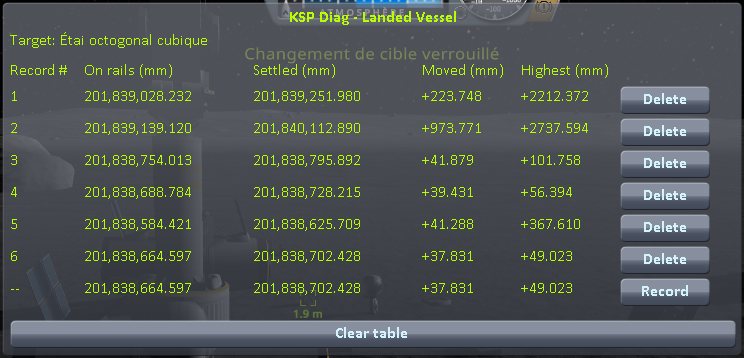

# The window

Part of [KSP Diag - Landed Vessel](../README.md): the table the mod shows in flight, column by column.

In flight, a window shows a table with one line per reading, in millimetres. The **bottom line is the
reading in progress**: its numbers move as you watch, it carries `--` where the others carry a record
number, and the *Record* button at the end of it freezes it into the table. The table survives scene
changes, so the lines pile up as you reload. `Alt+F6` hides the window, and shows it again.

**The numbers are about the craft you are flying, or about your target when you have set one on
another craft.** The line above the table says which, by name — `Craft you are flying: …` or
`Target: …` — so that a reading is never about a craft you did not mean. Targeting anything that is
not a craft, a planet or a docking port, changes nothing: the window stays on the craft you are
flying.

That is what lets you measure a craft you are not in. Park one, target it, and drive away: the table
keeps following it. Past 2250 m the game unloads it and there is nothing left to read, which the line
says in as many words — `Target: … -- too far away to read` — and every column falls back to `--`
until you are close enough again.

| column | meaning |
|---|---|
| **On rails** | the last height the game held the craft at while it was running it on rails, before physics started on it — the position the game places the craft at when it brings it into the world, whatever the reason: a save loaded, a craft you switch to, a craft you come back close to (physics starts on it once you are within 200 m) |
| **Settled** | the distance right now, running live until you press the button — so, once the craft has come to rest |
| **Moved** | **Settled** minus **On rails** — how far the craft ended up from the position it was given. Negative means it went down |

What the sign of **Moved** is worth, and what it does not tell, is in
[This mod's demonstration](this-mods-demonstration.md#what-this-instrument-shows-and-what-it-does-not).

While the craft is still on rails, the live line reads the same distance in both columns and **Moved**
reads `0.000`; from the first step of physics on, **Settled** follows the craft.

Every frozen line carries a *Delete* button, so a line recorded too early — before the craft had
finished settling — costs one click to throw away. *Clear table* throws away the lot. The table lives
in memory only, and empties itself when KSP is closed.

